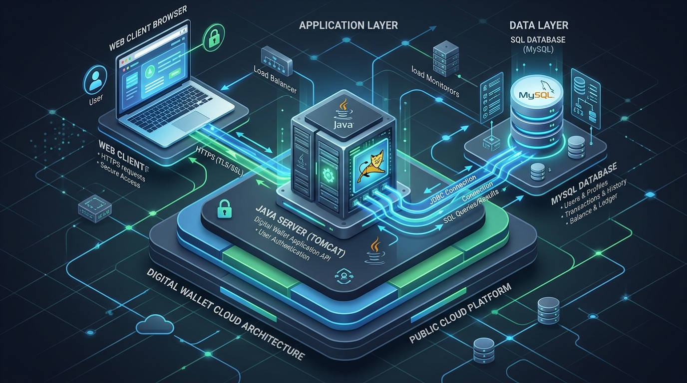
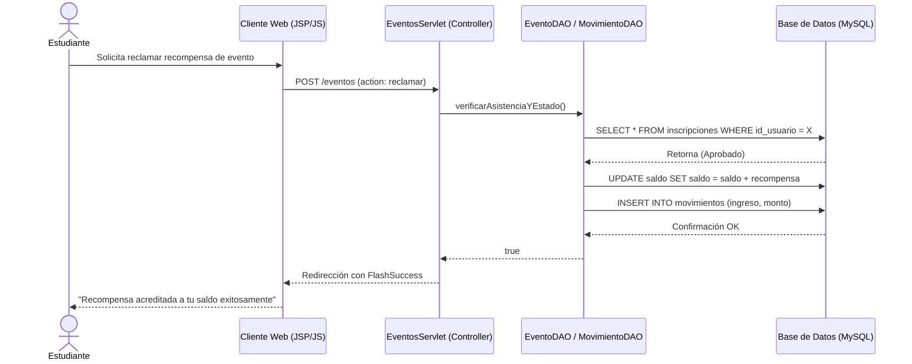

<div align="center">
  
  
  # UTS DUTS
  **Plataforma Financiera Institucional - Unidades Tecnológicas de Santander**
  
  [](https://java.com)
  [](https://maven.apache.org/)
  [](https://mysql.com)
  [](https://tomcat.apache.org/)
</div>

---

## ¿Qué es UTS DUTS y qué busca lograr?

**UTS DUTS** es un sistema web académico innovador desarrollado para simular un ecosistema financiero y de recompensas estudiantil para las **Unidades Tecnológicas de Santander**. Su moneda virtual principal, el **DUTS (Puntos de Mérito Institucional)**, permite a los estudiantes interactuar económicamente dentro de un entorno controlado y seguro.

### Objetivos de la Plataforma
1. **Fomentar la Participación:** Recompensar a los estudiantes con DUTS por participar en eventos institucionales, congresos, semilleros y actividades culturales.
2. **Educación Financiera Práctica:** Brindar una experiencia práctica sobre el manejo de una billetera digital, permitiendo transferencias de puntos, revisión de extractos y comprensión de conceptos de saldos y transacciones.
3. **Gestión Académica Integral:** Entregar herramientas administrativas para la gestión de usuarios, roles (Administrador/Estudiante), y control de asistencia/inscripción a eventos.

---

## Arquitectura del Sistema

El sistema sigue una arquitectura moderna en la nube basada en componentes. Consta de un **Cliente Web**, un **Servidor de Aplicaciones Java** y un **Motor de Base de Datos SQL**.

<div align="center">
  
</div>

### Diagrama de Secuencia Transaccional (Mermaid)
El siguiente diagrama explica cómo funciona el flujo cuando un estudiante asiste a un evento y reclama sus DUTS.



---

## Tecnologías Empleadas

El proyecto está diseñado bajo una arquitectura robusta y escalable utilizando estándares de la industria para desarrollo web en Java:

* **Backend:** Java 21, Servlets (Jakarta EE / Java EE), JSTL.
* **Arquitectura:** Modelo-Vista-Controlador (MVC).
* **Gestor de Proyectos y Dependencias:** Maven.
* **Seguridad:** BCrypt para hashing de contraseñas, Filtros de Sesión.
* **Generación de Reportes:** iTextPDF para la creación dinámica de facturas electrónicas y extractos.
* **Base de Datos:** MySQL 8.0.
* **Frontend:** HTML5, CSS3, JavaScript Vanilla.
* **Servidor de Despliegue:** Apache Tomcat 9 / 10.

---

## Instalación y Ejecución Local

Sigue estos pasos para levantar el proyecto en tu entorno de desarrollo local (ej. XAMPP + VS Code/Eclipse):

1. **Clonar y Preparar la Base de Datos**
   * Asegúrate de tener MySQL corriendo.
   * Importa el script de la base de datos (por ejemplo, `database_schema.sql` si se provee en la carpeta `sql/`).
   * Configura las credenciales de tu base de datos en el archivo: `src/main/java/co/edu/uts/duts/util/DatabaseConnection.java` si tu usuario no es `root` o tienes contraseña.

2. **Compilar el Proyecto**
   Abre una terminal en la raíz del proyecto y ejecuta Maven:
   ```bash
   mvn clean install
   ```

3. **Despliegue**
   * **Con Tomcat Embebido (Plugin Maven):** Puedes usar `mvn tomcat7:run` (si tienes configurado el plugin en `pom.xml`).
   * **Con Servidor Local:** Despliega el archivo `.war` generado (dentro de `target/`) en la carpeta `webapps` de tu instalación de Tomcat. Alternativamente, utiliza la extensión **Community Server Connectors** en VS Code o añade el proyecto al servidor Tomcat en Eclipse.

4. **Acceso**
   Una vez corriendo, accede a la plataforma en tu navegador web:
   ```
   http://localhost:8080/UTS_DUTS
   ```
   *(El puerto y el contexto pueden variar dependiendo de tu configuración).*
