<div align="center">
  
  
  # UTS DUTS — Ecosistema de Méritos y Vida Universitaria
  ### Sistema de Recompensas y Méritos para las Unidades Tecnológicas de Santander
  
  [](https://www.oracle.com/java/)
  [](https://jakarta.ee/)
  [](https://maven.apache.org/)
  [](https://www.mysql.com/)
  [](https://tomcat.apache.org/)
  [](https://itextpdf.com/)
  [](https://mindrot.org/projects/jBCrypt/)
  [](https://www.uts.edu.co)

</div>

---

## Tabla de Contenido
1. [¿Qué es UTS DUTS y Propósito?](#qué-es-uts-duts-y-propósito)
2. [Arquitectura del Sistema](#arquitectura-del-sistema)
3. [Flujo de Funcionamiento y Ciclo Transaccional](#flujo-de-funcionamiento-y-ciclo-transaccional)
4. [Stack Tecnológico](#stack-tecnológico)
5. [Estructura del Proyecto y Módulos](#estructura-del-proyecto-y-módulos)
6. [Modelo de Base de Datos (DER)](#modelo-de-base-de-datos-der)
7. [API RESTful: Red Universitaria](#api-restful-red-universitaria)
8. [Instalación y Puesta en Marcha](#instalación-y-puesta-en-marcha)
9. [Galería de Funcionalidades (Capturas Reales)](#galería-de-funcionalidades-capturas-reales)
10. [Seguridad y Transaccionalidad ACID](#seguridad-y-transaccionalidad-acid)
11. [Créditos Institucionales](#créditos-institucionales)

---

## ¿Qué es UTS DUTS y Propósito?

**UTS DUTS** es un ecosistema web financiero y académico desarrollado a la medida para las **Unidades Tecnológicas de Santander (UTS)**. Introduce el **DUTS (Punto de Mérito Institucional)** como un token virtual que incentiva el aprendizaje y premia el compromiso de los estudiantes dentro de un entorno seguro y transparente.

```
       [ Actividades Académicas ] ────────┐
       [ Congresos & Semilleros  ] ───────┼──> ( + Puntos DUTS ) ──> [ Requisito de Grado: 70.000 pts ]
       [ Transferencias P2P      ] ───────┘
```

### Objetivos Clave
* **Estímulo al Mérito Universitario:** Recompensar a los alumnos con puntos DUTS por su asistencia a conferencias, olimpiadas, talleres y semilleros de investigación.
* **Educación Financiera Integral:** Capacitar a los estudiantes en el uso práctico de billeteras electrónicas, transferencias interpersonales seguras y conciliación de extractos.
* **Meta Obligatoria de Grado:** Los estudiantes monitorean su avance hacia el cumplimiento del requisito institucional de **70.000 DUTS** acumulados a lo largo de su carrera.
* **Facturación Oficial Automatizada:** Expedición de comprobantes digitales con folios de auditoría generados en PDF bajo estándares institucionales.

---

## Arquitectura del Sistema

El sistema implementa el patrón **Modelo-Vista-Controlador (MVC)** multinivel, desacoplando la lógica de negocio, el control de acceso y la persistencia relacional.

<div align="center">
  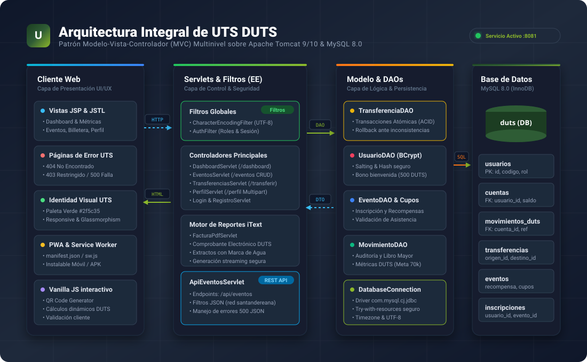
</div>

### Desglose de Capas

| Capa | Tecnologías | Responsabilidad |
| :--- | :--- | :--- |
| **Capa 1: Presentación (UI/UX)** | JSP, JSTL, Vanilla CSS3, PWA | Renderizado dinámico en servidor, vistas responsivas, identidad visual verde UTS (`#2f5c35`), y soporte para dispositivos móviles mediante Progressive Web App. |
| **Capa 2: Control y Filtros (EE)** | Servlets 4.0, Filter API, iTextPDF | Manejo del enrutamiento HTTP, validación de sesiones con `AuthFilter`, estandarización de caracteres en UTF-8 con `CharacterEncodingFilter`, y generación de PDFs. |
| **Capa 3: Lógica y DAOs** | DAO Pattern, Java 21, BCrypt | Reglas de negocio financieras, transacciones con control de concurrencia, cálculo de métricas de graduación y hashing seguro de credenciales. |
| **Capa 4: Persistencia (Datos)** | MySQL 8.0 (Motor InnoDB) | Almacenamiento seguro, llaves foráneas, tablas de auditoría y transacciones atómicas con garantía de integridad referencial. |

---

## Flujo de Funcionamiento y Ciclo Transaccional

El ecosistema transaccional DUTS garantiza un flujo paso a paso claro y auditable desde el primer acceso del estudiante hasta la descarga de su comprobante final:

<div align="center">
  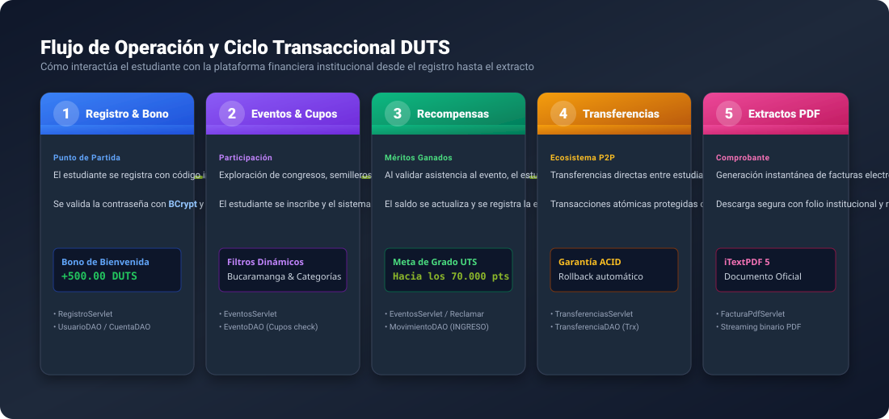
</div>

1. **Registro con Bono Inicial:** El estudiante crea su cuenta institucional; el sistema aplica hash BCrypt y apertura automáticamente una cuenta asociada con un **bono de bienvenida de 500.00 DUTS**.
2. **Inscripción a Eventos:** Exploración de la agenda académica de Bucaramanga y reserva de cupos en tiempo real (`EventoDAO`).
3. **Reclamación de Recompensas:** Al confirmarse la asistencia, el alumno reclama su mérito. El saldo se incrementa y se contabiliza en el progreso hacia los **70.000 DUTS de grado**.
4. **Transferencias P2P Seguras:** Envío de fondos entre alumnos mediante código estudiantil o username. La operación se procesa de forma atómica (`con.setAutoCommit(false)`), asegurando débito y crédito simultáneos.
5. **Generación de Factura & Extracto:** Emisión instantánea de comprobantes oficiales mediante `FacturaPdfServlet` con streaming de PDF firmado y marca de agua institucional.

---

## Stack Tecnológico

<div align="center">
  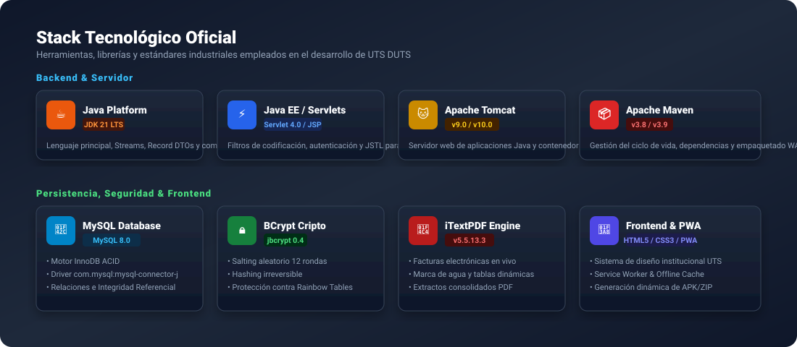
</div>

* **Lenguaje Core:** Java 21 LTS (OpenJDK), aprovechando el compilador moderno `--release 21`.
* **Capa Web:** Java Servlet 4.0 (`javax.servlet-api:4.0.1`), JavaServer Pages (`javax.servlet.jsp-api:2.3.3`) y JSTL 1.2.
* **Seguridad Criptográfica:** jBCrypt 0.4 para el salting aleatorio (12 rondas) y hashing irreversible de contraseñas.
* **Generador de Reportes:** iTextPDF 5.5.13.3 para construcción dinámica en streaming de extractos y facturas oficiales.
* **Base de Datos & Driver:** MySQL 8.0 InnoDB junto con `com.mysql:mysql-connector-j:8.0.33`.
* **Herramienta de Construcción:** Apache Maven 3.8 / 3.9 con empaquetado `.war` y plugin `tomcat7-maven-plugin:2.2`.
* **Servidor de Aplicaciones:** Compatible con Apache Tomcat 9 y 10.

---

## Estructura del Proyecto y Módulos

El proyecto sigue rigurosamente el estándar Maven Standard Directory Layout (`src/main/java` y `src/main/webapp`):

<div align="center">
  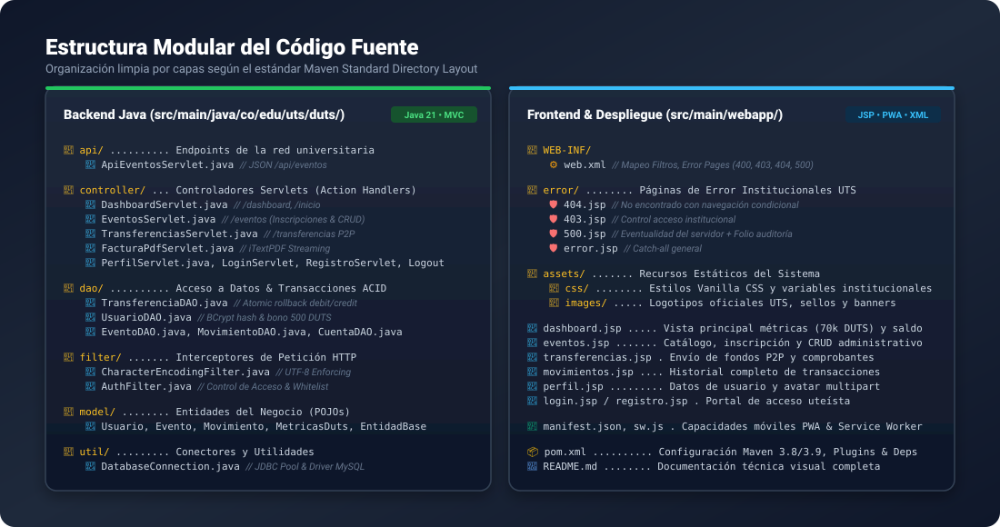
</div>

```
uts-duts-plataforma/
├── Dockerfile                                # Configuración multicapa para despliegue en la nube
├── pom.xml                                   # Configuración de dependencias Maven y Tomcat
├── README.md                                 # Documentación técnica visual
├── sql/
│   └── schema.sql                            # Script de base de datos MySQL y datos semilla
├── assets/
│   └── images/                               # Recursos gráficos vectoriales (SVG) y capturas
│       ├── banner.png                        # Portada de cabecera
│       ├── architecture.svg                  # Diagrama de arquitectura multinivel
│       ├── workflow.svg                      # Infografía del ciclo transaccional
│       ├── technologies.svg                  # Stack de tecnologías
│       ├── project-structure.svg             # Diagrama de estructura de directorios
│       ├── database.svg                      # Modelo Entidad-Relación
│       ├── api.svg                           # Especificación gráfica de la API
│       ├── installation.svg                  # Guía de pasos de instalación
│       └── features/                         # Capturas de pantalla reales del sistema
│           ├── login.png
│           ├── registro.png
│           ├── error-404.png
│           ├── error-403.png
│           └── error-500.png
└── src/
    └── main/
        ├── java/co/edu/uts/duts/
        │   ├── api/                          # Endpoints REST (ApiEventosServlet.java)
        │   ├── controller/                   # Servlets controladores (Dashboard, Eventos, etc.)
        │   ├── dao/                          # Objetos de Acceso a Datos y transacciones ACID
        │   ├── filter/                       # CharacterEncodingFilter y AuthFilter
        │   ├── model/                        # Entidades del dominio (Usuario, Evento, etc.)
        │   └── util/                         # Conexión JDBC (DatabaseConnection.java)
        └── webapp/
            ├── WEB-INF/web.xml               # Descriptor de despliegue y mapeo de errores
            ├── error/                        # Páginas de error institucionales (403, 404, 500)
            ├── assets/                       # CSS vanilla, logos y favicons oficiales
            ├── dashboard.jsp                 # Panel principal con saldos y metas
            ├── eventos.jsp                   # Catálogo y administración de eventos
            ├── transferencias.jsp            # Módulo de transferencias P2P
            ├── movimientos.jsp               # Extractos y libro mayor
            ├── perfil.jsp                    # Gestión de perfil y avatar multipart
            ├── login.jsp / registro.jsp      # Portales de autenticación institucional
            └── manifest.json / sw.js         # Configuración Progressive Web App (PWA)
```

---

## Modelo de Base de Datos (DER)

La base de datos relacional `duts` en MySQL 8.0 implementa normalización en Tercera Forma Normal (3FN), garantizando consistencia, auditoría y relaciones estrictas:

<div align="center">
  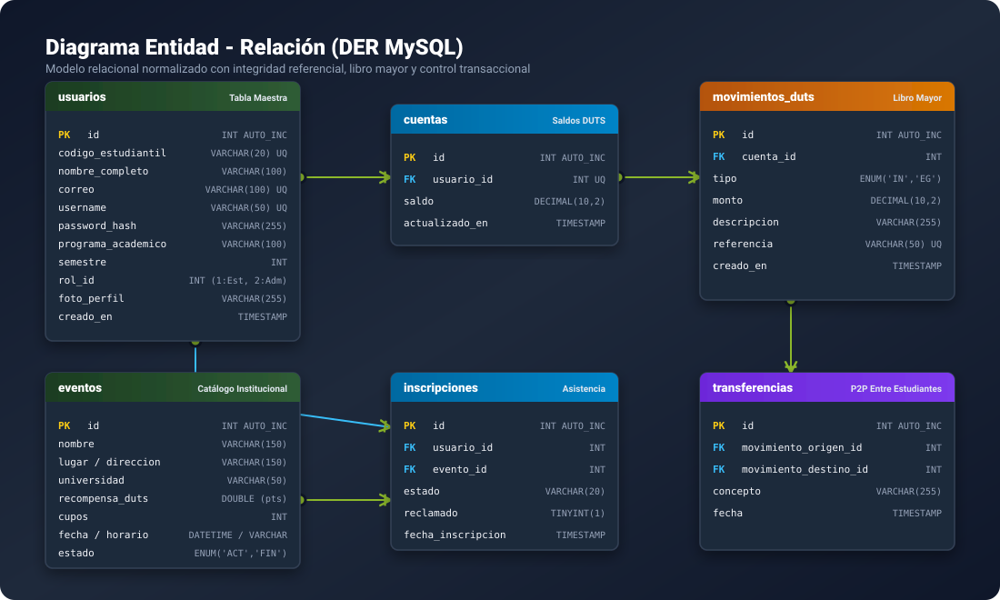
</div>

### Resumen de Entidades Principales

* **`usuarios`:** Almacena código estudiantil único, correo institucional, hash seguro BCrypt, semestre, programa académico y rol (`1 = Estudiante`, `2 = Administrador`).
* **`cuentas`:** Relación 1 a 1 estricta con `usuarios`, gestionando el saldo actual disponible en DUTS.
* **`movimientos_duts`:** Libro mayor inmutable de la plataforma; cada registro almacena tipo (`INGRESO` o `EGRESO`), monto, descripción y folio único de referencia.
* **`transferencias`:** Registra las operaciones entre pares (P2P), vinculando el movimiento de débito del emisor con el de crédito del receptor.
* **`eventos`:** Catálogo de actividades, conferencias y congresos universitarios con recompensa en DUTS, fecha, cupos y estado.
* **`inscripciones`:** Tabla intermedia que gestiona la participación de los alumnos en eventos y el control de reclamación de recompensas.

---

## API RESTful: Red Universitaria

La plataforma expone una API REST ligera para interoperar con otras instituciones académicas del departamento de Santander (UIS, UNAB, UDES y nodo ASCUN):

<div align="center">
  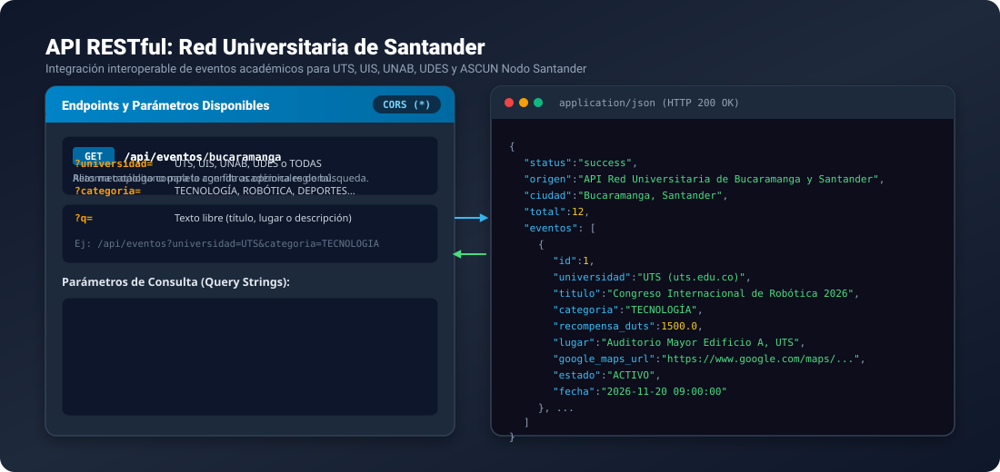
</div>

### Endpoints Disponibles

#### `GET /api/eventos` y `GET /api/eventos/bucaramanga`
Retorna la agenda de eventos académicos y extracurriculares con recompensas DUTS en formato JSON.

* **Cabeceras de Respuesta:** `Content-Type: application/json;charset=UTF-8`, `Access-Control-Allow-Origin: *`
* **Parámetros Opcionales:**
  * `universidad`: Filtra por universidad (`UTS`, `UIS`, `UNAB`, `UDES`, `TODAS`).
  * `categoria`: Filtra por tipo de evento (`TECNOLOGIA`, `ROBOTICA`, `DEPORTES`, `EMPRENDIMIENTO`).
  * `q`: Búsqueda textual por título, lugar o descripción.

#### Ejemplo de Respuesta:
```json
{
  "status": "success",
  "origen": "API Red Universitaria de Bucaramanga y Santander",
  "ciudad": "Bucaramanga, Santander",
  "total": 6,
  "eventos": [
    {
      "id": 1,
      "universidad": "UTS (uts.edu.co)",
      "titulo": "Congreso Internacional de Robótica 2026",
      "categoria": "TECNOLOGÍA",
      "puntos": 1500,
      "recompensa_duts": 1500.0,
      "lugar": "Auditorio Mayor Edificio A, UTS",
      "cupos": 120,
      "estado": "ACTIVO",
      "google_maps_url": "https://www.google.com/maps/search/?api=1&query=...",
      "fecha": "2026-11-20 09:00:00"
    }
  ]
}
```

---

## Instalación y Puesta en Marcha

<div align="center">
  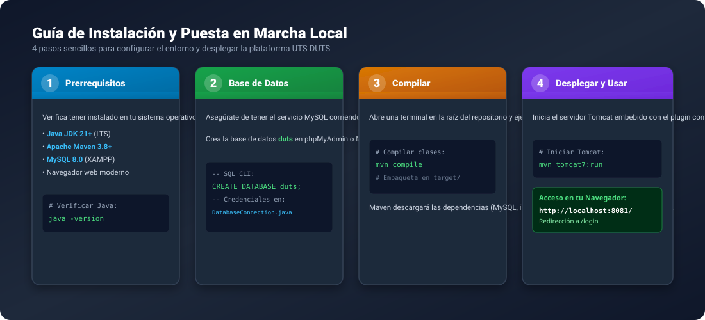
</div>

Sigue estos 4 pasos para desplegar el proyecto en tu entorno local:

### 1. Preparar la Base de Datos
Inicia el servicio de MySQL (puerto 3306) y crea la base de datos `duts`:
```sql
CREATE DATABASE duts CHARACTER SET utf8mb4 COLLATE utf8mb4_unicode_ci;
```
*(Si tu usuario de MySQL no es `root` o tiene contraseña, ajusta las credenciales en `DatabaseConnection.java` o pásalas como variable de entorno).*

### 2. Compilar el Código
En la raíz del proyecto, ejecuta Maven para compilar las clases:
```bash
mvn compile
```

### 3. Iniciar el Servidor Embebido Tomcat
Inicia el plugin de Tomcat configurado en el puerto `8081`:
```bash
mvn tomcat7:run
```

### 4. Acceder al Sistema
Abre tu navegador e ingresa a:
```
http://localhost:8081/
```
El filtro redirigirá automáticamente a la pantalla de bienvenida institucional: `http://localhost:8081/login`.

---

## Galería de Funcionalidades (Capturas Reales)

Las siguientes capturas han sido tomadas directamente del entorno de ejecución activo:

### Portal de Acceso Uteísta
Acceso unificado con correo institucional, diseño responsive, barra Gov.co y enlaces rápidos.
<div align="center">
  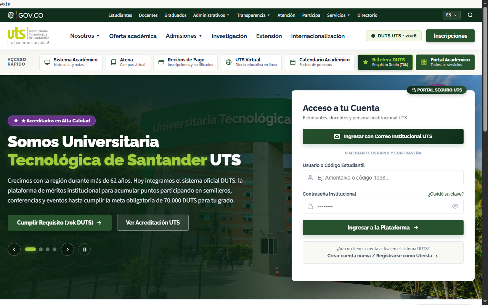
</div>

### Registro de Nuevos Estudiantes
Formulario validado en el servidor con otorgamiento automático de 500 DUTS de bono de bienvenida.
<div align="center">
  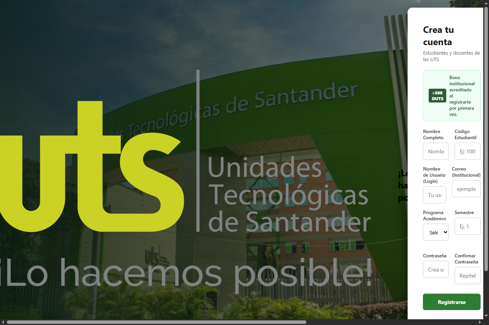
</div>

### Sistema de Prevención y Páginas de Error Institucionales
Diseños adaptativos que cambian dinámicamente según si el estudiante ha iniciado sesión o no:

| HTTP 404 - No Encontrado | HTTP 403 - Acceso Restringido | HTTP 500 - Falla con Folio |
| :---: | :---: | :---: |
| 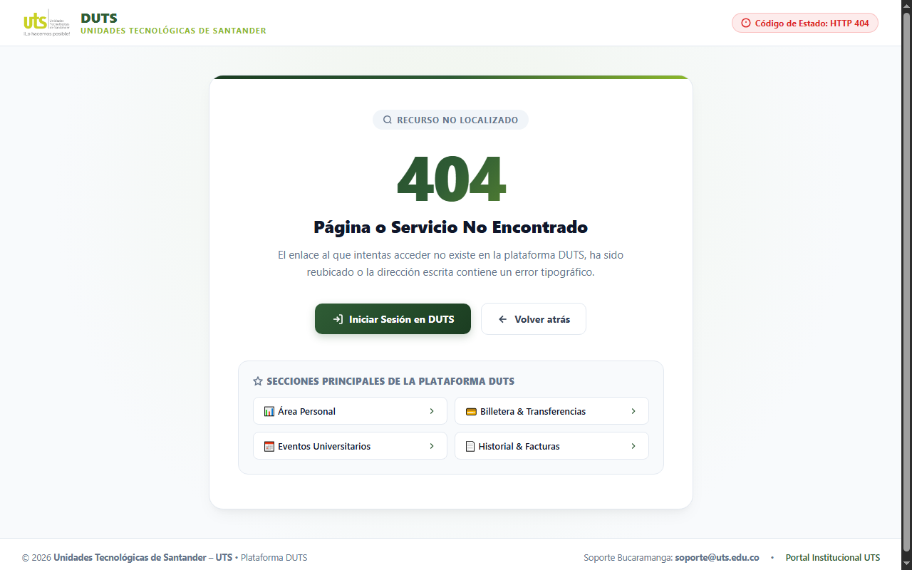 | 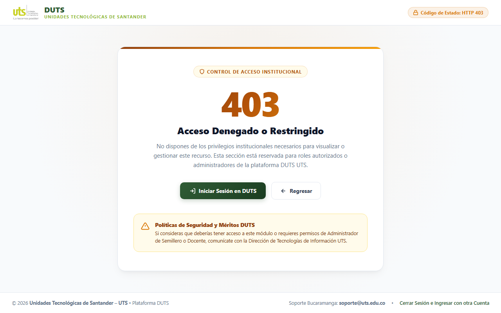 | 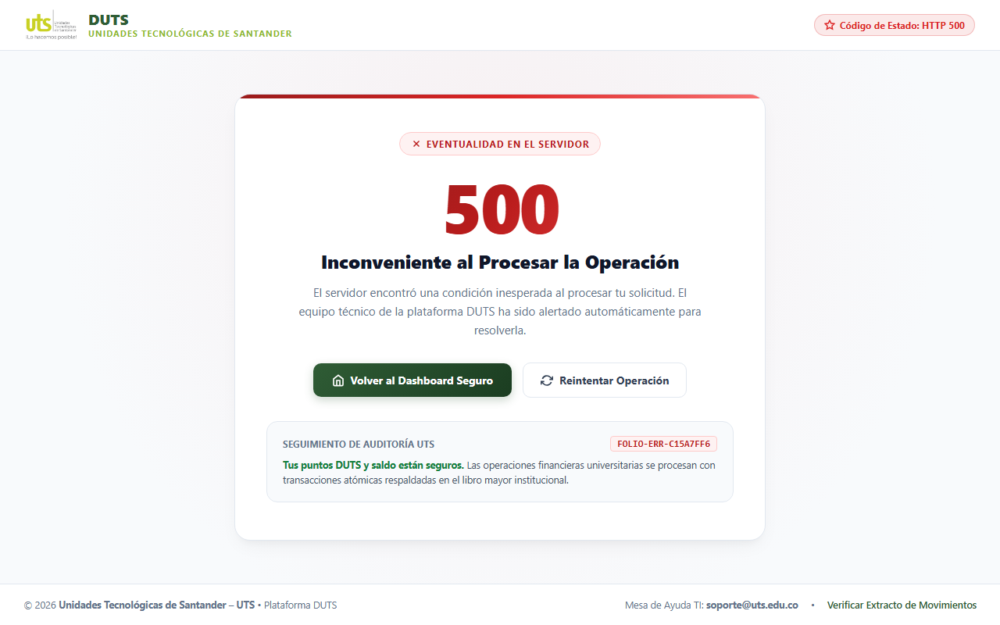 |
| Enlaces rápidos a Dashboard, Transferencias y Eventos | Aviso de control de roles y enlace a soporte TI | Folio de auditoría y confirmación de saldos seguros |

---

## Seguridad y Transaccionalidad ACID

El sistema incorpora múltiples capas de protección técnica:

1. **Hashing Criptográfico BCrypt:** Las contraseñas de los estudiantes nunca se almacenan en texto plano; se utiliza salting aleatorio con coste de cálculo 12.
2. **Atomicidad en Transferencias (ACID):** Toda operación de transferencia ejecuta una transacción controlada:
   ```java
   con.setAutoCommit(false);
   // 1. Debitar cuenta origen
   // 2. Acreditar cuenta destino
   // 3. Registrar movimientos de auditoría en libro mayor
   // 4. Registrar transferencia vinculada
   con.commit(); // O con.rollback() ante cualquier excepción
   ```
3. **Filtro de Codificación UTF-8:** `CharacterEncodingFilter` garantiza la correcta visualización de caracteres especiales, tildes y nombres en español.
4. **Protección de Rutas Privadas:** `AuthFilter` intercepta cualquier intento de acceso no autorizado y redirige al login, permitiendo navegación libre en páginas de error y assets públicos.

---

## Créditos Institucionales

* **Institución:** Unidades Tecnológicas de Santander — UTS
* **Campus:** Bucaramanga, Santander, Colombia
* **Plataforma:** DUTS (Puntos de Mérito Institucional)
* **Soporte y Mesa de Ayuda:** `soporte@uts.edu.co`
* **Portal Web Oficial:** [www.uts.edu.co](https://www.uts.edu.co)

<div align="center">
  <br>
  <sub>© 2026 <strong>Unidades Tecnológicas de Santander – UTS</strong> • Plataforma DUTS Institucional.</sub>
</div>
